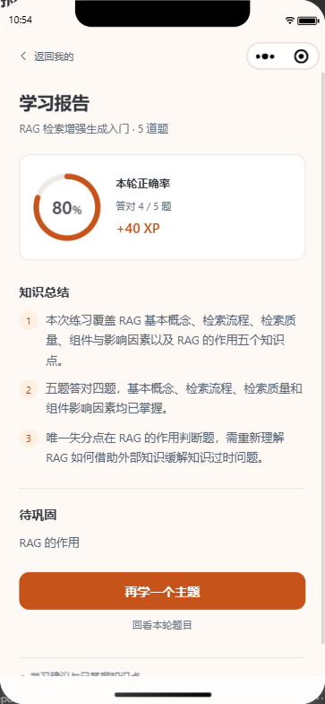

# 学习咩 · AI 闯关学习小程序（AI-Learn）

> 把好奇，变成一小关。
>
> 输入学习主题，让 AI 把知识变成题目，在答题、讲解和复盘中完成一轮学习。

## 一、项目介绍

学习咩是参考鱼皮 [yu-ai-learn](https://github.com/liyupi/yu-ai-learn) 的 AI 学习项目，使用 **Taro + React + FastAPI + LangChain + DeepSeek**，支持微信小程序和 H5。本仓库保留自己的页面设计、代码实现与学习记录，功能以当前源码为准。

输入主题、粘贴正文或提供公开网页链接，系统获取资料并生成一组关卡；每题提交后给出正确答案和讲解，完成后生成复盘报告。登录后可以保存云端记录，也可以从“我的知识库”上传自己的学习资料。

<table>
  <tr><th>输入学习主题</th><th>闯关答题</th><th>学习报告</th></tr>
  <tr>
    <td></td>
    <td></td>
    <td></td>
  </tr>
</table>

以上是历史微信开发者工具模拟器实测截图，详细条件见[验收记录](docs/验收记录/README.md)。

### 为什么做这个项目？

读过一段知识，不一定能把它讲清楚。学习咩把“读资料”变成“做一组小练习”：通过题目主动思考，通过讲解查漏补缺，再用报告回顾这一轮的收获。默认五题，适合概念入门、短文本自测与碎片时间复习。

为什么做成微信小程序，而不是 App 或者网页？因为学习这件事发生在碎片时间里，微信小程序免安装、随时随地能打开、依托微信生态的流量入口、还便于分享给朋友一起卷，对一个学习类产品来说几乎是最优形态。

更重要的是，这个项目的骨架可以直接复用到任何垂直领域，换个知识源就是一个新产品，比如驾考宝典、面试题库、企业内部培训考核、职业资格考试复习、儿童英语单词闯关等等。

### 七项核心能力

| 能力 | 当前效果 |
| --- | --- |
| 主题、正文和网页出题 | 最多输入 2000 字符；先获取资料，主题有歧义时先选领域，资料不足时提示补充 |
| 三种题型与即时讲解 | 单选、多选、判断；提交后展示答案、讲解和知识点，多选完整匹配才算正确 |
| 学习报告 | 正确率、答对题数、XP、三句总结、薄弱点、建议与题目回看；每答对一题获得 10 XP |
| 退出后继续 | 本机保存题目、答案和位置，已答题目不会重复结算 |
| 题库与个人统计 | 搜索、状态筛选、历史报告、昵称、累计 XP 与正确率统计 |
| 登录与云端记录 | 微信登录；同账号读取题库与最终报告，游客和不同账号的缓存互相隔离 |
| 私有文档知识库 | PDF、DOCX、Markdown、TXT；每人最多 10 篇、每篇 10MB；先检索文档，再联网补充，仍不足时明确提示模型兜底 |

文档出题的模型兜底不等于资料核实通过；普通首页出题资料不足仍会暂停。未完成作答只保留在本机，游客记录不自动迁入账号。视频解析、AI 配图、分享海报、排行榜和支付尚未实现。

## 二、技术选型与目录

前后端分开运行，后端负责资料获取、出题、计分和保存，前端负责交互、账号缓存与本机进度。后端已提供 [微信云托管 Docker 配置](docs/微信云托管部署指南.md)，尚待实际镜像构建与云端验收；API 启动不会自动建库建表。

| 层面 | 本仓使用的技术 |
| --- | --- |
| 前端 | Taro 4.3.1 · React 18 · TypeScript · Webpack 5 |
| 后端 | Python 3.11 · FastAPI · Pydantic v2 · Uvicorn |
| AI 与检索 | LangChain · langchain-deepseek · DeepSeek · Tavily；检索使用 LangChain create_agent |
| 知识库 | 百炼 text-embedding-v4 · 本地 Chroma · pypdf · docx2txt |
| 账号与数据 | 微信 code2session · JWT · MySQL 8 · aiomysql |
| 验证 | pytest · Node.js test runner · tsx · TypeScript · 微信构建检查 |

```text
AI-Learn/
├── backend/          # API、AI 服务、数据访问、SQL 与 pytest
├── frontend/         # 六个页面、组件、业务状态与双端构建
├── prototype/        # 使用模拟数据的 HTML 交互原型
├── docs/             # 当前需求、架构、运行与维护指南
│   └── 验收记录/     # 可公开的验收摘要与展示截图
├── openspec/         # 已同步规范、进行中变更与归档
└── .github/          # 项目已有的 OpenSpec 技能与提示词
```

目录职责和修改入口见[项目维护指南](docs/项目维护指南.md)。`dist/`、虚拟环境、数据库和临时调试产物不纳入源码。

## 三、快速运行

以下命令在 Windows PowerShell 执行。需要 Python 3.11、Node.js/npm；账号与知识库另需 MySQL 8。完整配置、数据库初始化、微信导入和排错见[保姆级本地运行指南](docs/保姆级本地运行指南.md)。

### 1. 启动后端

从项目根目录进入后端，安装依赖并创建本机配置。已有 `.env` 时保留，修改配置后重启服务。

```powershell
cd backend
if (-not (Test-Path .venv/Scripts/python.exe)) { python -m venv .venv }
./.venv/Scripts/python.exe -m pip install -r requirements.txt
if (-not (Test-Path .env)) { Copy-Item .env.example .env }
```

编辑 `.env`，填写 `DEEPSEEK_API_KEY`；普通主题和网页出题还需要 `TAVILY_API_KEY`。不配置 Tavily 时，可以使用充分的学习正文，但不会自动改用模型知识出题。知识库需要另配百炼，账号需要配置 MySQL 与 JWT。

```powershell
./.venv/Scripts/python.exe -m uvicorn app.main:app --host 127.0.0.1 --port 8000
```

打开 [API 文档](http://127.0.0.1:8000/docs)；[健康检查](http://127.0.0.1:8000/api/v1/health) 在未配 Key 时也应返回 `data.status="ok"`。

### 2. 启动前端

新开终端，从项目根目录执行以下命令，打开 [H5 预览](http://127.0.0.1:10086)。前端配置仅包含 API 地址与开发登录开关，密钥放在后端。

```powershell
cd frontend
npm.cmd ci
if (-not (Test-Path .env)) { Copy-Item .env.example .env }
npm.cmd run dev:h5
```

需要微信小程序时，改为运行 `npm.cmd run dev:weapp`，用微信开发者工具导入 **frontend 目录**。项目配置指向 `dist/weapp`；本地 HTTP 调试在开发者工具中关闭合法域名校验。默认 `touristappid` 用于本地游客模拟器；真机与真实微信登录需要自己的 AppID 和可访问的后端地址。

## 四、测试与验证

自动化测试替换外部模型、检索和微信响应，不消耗 AI 额度。后端完整回归需要专用 `_test` 数据库，不能指向应用库；具体准备和完整检查命令见[维护指南](docs/项目维护指南.md)。

```powershell
# 在 backend/ 执行
./.venv/Scripts/python.exe -m pytest -q --tb=short
./.venv/Scripts/python.exe -m pip check
```

```powershell
# 在 frontend/ 执行
npm.cmd test
npm.cmd run typecheck
npm.cmd run build:h5
npm.cmd run build:weapp
node tests/weapp-startup-smoke.cjs
```

构建成功仍需微信原生样式编译和模拟器检查。自动化结果、历史真实 AI 联调、用户体验和真机验收分别记录，不互相替代；真实微信凭据与真机仍待验证。

## 五、项目文档

文档模仿参考项目先讲问题、再讲方案和操作的方式，内容按本仓实现更新。希望系统学习时，可依次阅读需求、总方案、专题设计和验收记录。

| 文档 | 解决什么问题 |
| --- | --- |
| [文档导航](docs/README.md) | 快速找到运行、开发与验收入口 |
| [需求分析](docs/需求分析文档.md) | 当前功能、用户流程、限制与后续方向 |
| [方案设计](docs/方案设计文档.md) | 实际架构、数据流和模块职责 |
| [本地运行指南](docs/保姆级本地运行指南.md) | 从环境配置到首次运行 |
| [项目维护指南](docs/项目维护指南.md) | 目录规则、代码自检、测试与本次整理记录 |
| [上线前仓库检查](docs/上线前仓库检查.md) | 提交范围、本地资料存放和正式发布前待办 |
| [历史验收](docs/验收记录/README.md) | 已发生的验证与证据 |

知识库已完成实现、阶段验收、主规范同步与 OpenSpec 归档，历史和参考资料的区别见 [OpenSpec 导航](openspec/README.md)。后续可扩展错题复习和更细的学习统计；正式上线仍需完成生产环境与真机验收。
