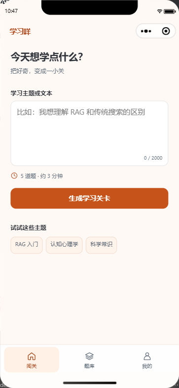
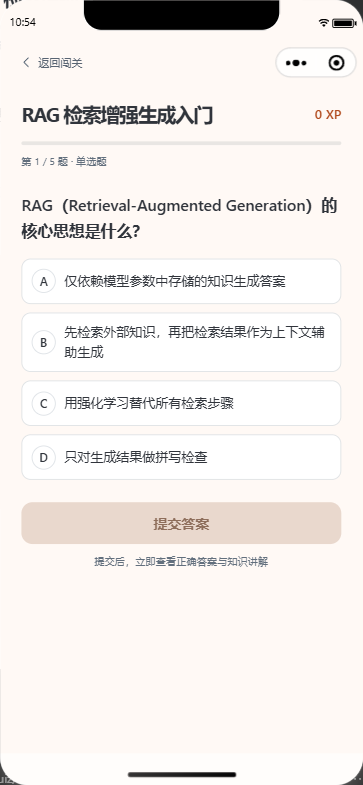
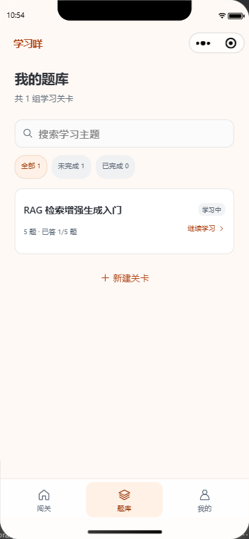
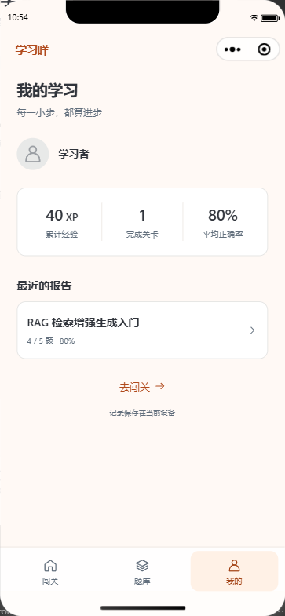

# 学习咩 · AI 闯关学习小程序（AI-Learn）

> 把好奇，变成一小关。
>
> 输入想学的主题，让 AI 把知识变成题目，在答题、讲解和复盘中完成一轮学习。

## 一、项目介绍

学习咩是一款基于 **Taro + React + Python FastAPI + LangChain + DeepSeek** 开发的 AI 闯关学习微信小程序，同时支持 H5 预览。

输入一句学习目标，或粘贴一段学习材料，AI 会生成一组闯关题目。每题提交后立即展示正确答案和完整讲解，完成后生成学习报告，帮助你回顾答对了什么、还需要巩固什么。

当前包含 **输入、答题、报告、题库、“我的”五个页面**，并已接入用户系统。登录后生成的题库、完整作答和报告保存在 MySQL，可从同一账号的其他客户端读取；游客记录和未完成进度保留在当前设备。

<table>
  <tr>
    <th>输入学习主题</th>
    <th>闯关答题</th>
    <th>学习报告</th>
  </tr>
  <tr>
    <td></td>
    <td></td>
    <td></td>
  </tr>
</table>

*以上为微信开发者工具游客模拟器中的实际运行截图。*

### 为什么做这个项目？

学习一个新主题时，读懂内容只是开始。能否回答问题、解释概念，并发现自己理解中的空白，才更容易判断这一轮学习有没有收获。

学习咩把这个过程拆成一组小关卡：先确定学习主题，再通过题目主动思考，最后结合讲解和报告复盘。每轮默认五题，适合概念入门、短文本自测和碎片时间复习。

### 6 项核心能力

1. **输入主题，生成学习关卡。**

   支持一句话或一段文本，最多 2000 字。AI 根据输入生成题目、选项、答案、讲解和对应知识点，前端默认每轮五题。

2. **三种题型，提交后立即反馈。**

   支持单选、多选、判断。选择后点击“提交答案”，立即高亮正确答案并展开知识讲解。多选需要完整命中答案集合；答对获得 10 XP，答错获得 0 XP。

3. **AI 生成学习复盘报告。**

   展示本轮正确率、答对题数、XP、三句话知识总结、待巩固知识点和学习建议，还可以回看本轮题目与作答。统计由后端重新计算，AI 负责生成总结和建议。

4. **中途退出，保留学习进度。**

   已生成的关卡、提交的答案和当前位置保存在本机。退出后可从题库继续，已经答过的题目不会重复结算 XP。

5. **题库搜索与状态筛选。**

   在题库中查找已生成的关卡，按学习状态筛选，继续未完成的练习，或打开已完成关卡的报告。

6. **查看个人学习统计。**

   首页显示账号昵称、XP 和最近报告；“我的”支持修改昵称，展示累计 XP、完成关卡数、累计答对题数、平均正确率和分页历史。题库支持云端搜索和状态筛选，不同账号的数据独立保存。

<table>
  <tr>
    <th>题库与进度恢复</th>
    <th>我的学习</th>
  </tr>
  <tr>
    <td></td>
    <td></td>
  </tr>
</table>

## 二、项目特点

- **完整的学习闭环。** 从主题输入到出题、答题、讲解、报告，再到历史回看，主要路径均可实际操作。
- **跨端实现。** 使用 Taro 维护小程序和 H5，页面布局、配色与交互依据仓库中的 UI 原型实现。
- **结构化 AI 输出。** 通过 LangChain 调用 DeepSeek，结合严格 JSON 解析、Pydantic 和业务规则校验题目与报告，并对异常结果进行有界重试。
- **学习过程可恢复。** 输入和答题记录保存在本机；出题失败可重新生成，报告失败保留成绩，支持重试。
- **测试驱动的后端开发。** 后端采用 TDD，覆盖输入校验、模型调用、判分、报告、异常处理和基础限流，并分别进行真实 AI 与小程序模拟器验收。

## 三、技术选型与项目结构

### 技术选型

| 层面 | 技术选型 |
| --- | --- |
| 小程序 / H5 前端 | Taro 4.3.1 · React 18 · TypeScript · CSS · Webpack5 |
| 后端服务 | Python 3.11 · FastAPI · Uvicorn · asyncio |
| 数据校验 | Pydantic v2 · pydantic-settings |
| AI 编排与模型 | LangChain · langchain-deepseek / ChatDeepSeek · DeepSeek |
| 用户与学习记录 | MySQL 8 · aiomysql · PyJWT · Taro 本地缓存 |
| 后端测试 | pytest · pytest-asyncio · pytest-cov · httpx |
| 前端与平台检查 | Node.js test runner · tsx · TypeScript · 微信原生 WXSS 编译器 |

默认模型为 `deepseek-flash`，可通过后端环境变量调整。后端负责出题、重新判分、生成报告和账号数据保存；前端负责交互、身份状态、账号缓存与本机进度。

### 项目结构

```text
AI-Learn/
├── frontend/                 # Taro 小程序与 H5 工程
│   ├── src/                  # 五个页面、组件、业务逻辑与本地存储
│   ├── tests/                # 前端测试与平台回归
│   └── project.config.json   # 微信开发者工具项目配置
├── backend/                  # Python 后端
│   ├── app/                  # 接口、模型调用、校验与计分服务
│   ├── tests/                # 后端自动化测试
│   └── .env.example          # 后端环境变量示例
├── prototype/                # UI 交互原型
└── docs/                     # 需求、设计、执行方案与验收记录
```

## 四、快速运行

> 更详细的配置和接口说明见 [前端运行指南](frontend/README.md) 与 [后端运行指南](backend/README.md)。以下命令以 Windows PowerShell 为例，从项目根目录开始操作。

### 前置条件

- Python 3.11。
- Node.js 和 npm；本项目已验证 Node.js 24.19.0、npm 11.17.0。
- 微信开发者工具，用于运行小程序模拟器。
- DeepSeek API Key，用于真实出题和报告生成。
- MySQL 8，用于账号和云端记录；游客功能可独立运行。

### 1. 启动后端

在第一个终端执行：

```powershell
cd backend

# 创建虚拟环境；已有环境时直接使用
if (-not (Test-Path .venv/Scripts/python.exe)) { python -m venv .venv }

# 安装锁定依赖
./.venv/Scripts/python.exe -m pip install -r requirements.txt

# 首次复制配置，保留已经填写的 .env
if (-not (Test-Path .env)) { Copy-Item .env.example .env }
```

编辑 `backend/.env`，填写自己的 `DEEPSEEK_API_KEY`。密钥只保存在后端配置中。

```dotenv
DEEPSEEK_API_KEY=your_deepseek_api_key
DEEPSEEK_MODEL=deepseek-flash
```

然后在同一终端启动服务：

```powershell
./.venv/Scripts/python.exe -m uvicorn app.main:app --host 127.0.0.1 --port 8000
```

启动后访问 [API 文档](http://127.0.0.1:8000/docs)，可查看并调试接口。修改后端 `.env` 后需要重启服务。

账号功能还需在 `backend/.env` 配置 `MYSQL_HOST/PORT/USER/PASSWORD/DATABASE` 与随机 `JWT_SECRET`。先创建应用数据库及专用账号，再执行 `./.venv/Scripts/python.exe -m scripts.init_db` 初始化表；本机现有环境已经配置并初始化。独立测试库的配置保存在 `.env.test`，数据库名必须以 `_test` 结尾。具体字段、权限及初始化说明见 [后端运行指南](backend/README.md)。环境文件均不纳入版本库。

本地体验账号功能时，后端设置 `APP_ENV=development`、`DEV_LOGIN_ENABLED=true`，前端 `.env` 设置 `TARO_APP_DEV_LOGIN=true` 并使用回环 API 地址。重新构建后，在“我的”选择明确标注的“测试账号 A/B”。本机已启用此模式。真实微信登录需要在后端配置 `WECHAT_APP_ID/WECHAT_APP_SECRET`，并在 `frontend/project.config.json` 填写自己的 AppID；当前尚无真实凭据，官方登录与真机验收待完成。

### 2. 启动小程序前端

新开一个终端，从项目根目录执行：

```powershell
cd frontend
npm.cmd ci --registry=https://registry.npmjs.org
npm.cmd run dev:weapp
```

保持这个终端运行，源码修改后会重新编译。用微信开发者工具导入 **`frontend` 目录**，工具会读取 `project.config.json`，小程序构建目录为 `frontend/dist/weapp`。

#### 游客模式

保留配置中的 `touristappid`，即可进行本地游客模拟器调试。本机已验证的官方 CLI 启动方式如下，在 `frontend/` 目录执行：

```powershell
& 'D:/微信web开发者工具/cli.bat' auto --project (Get-Location).Path --auto-port 9420 --lang zh
```

CLI 路径按实际安装位置调整，并在工具的「设置 → 安全设置」中开启「服务端口」。本机版本的普通 `open` 命令拒绝游客 AppID，`auto` 入口已完成实测。

前端默认请求 `http://127.0.0.1:8000`。需要调整地址时，在前端 `.env` 中配置 `TARO_APP_API_BASE_URL`，再重新构建。真机调试需使用手机可访问的后端地址和自己的 AppID；正式环境还需配置 HTTPS 与微信合法域名。

### 3. 可选：H5 预览

在另一个终端进入 `frontend/`，执行：

```powershell
npm.cmd run dev:h5
```

打开 [H5 本地预览](http://127.0.0.1:10086)。如果端口已被运行中的预览服务占用，先停止对应服务再启动。

### 4. 生成构建产物

在 `frontend/` 执行：

```powershell
npm.cmd run build:weapp
npm.cmd run build:h5
```

产物分别位于 `frontend/dist/weapp` 和 `frontend/dist/h5`。

## 五、测试与验证

### 运行自动化检查

在 `backend/` 执行：

```powershell
./.venv/Scripts/python.exe -m pytest --cov=app --cov-branch --cov-report=term-missing
./.venv/Scripts/python.exe -m pip check
```

在 `frontend/` 执行：

```powershell
npm.cmd test
npm.cmd run typecheck
```

上述常规测试隔离外部模型调用，不消耗 AI 接口额度。真实 AI 抽检需要显式运行验收脚本，命令见 [后端运行指南](backend/README.md)。微信原生 WXSS 编译回归见 [前端运行指南](frontend/README.md)。

### 已完成的验证

| 检查项 | 已记录结果 |
| --- | --- |
| 后端自动化测试 | 261 项通过（保留原有 193 项），应用语句/分支合并覆盖率 98%，真实 MySQL 集成测试通过 |
| 前端自动化测试 | 71 项通过，类型检查通过 |
| 构建与原生编译 | H5、小程序构建及微信原生 WXSS 编译通过 |
| 小程序启动回归 | 真实生产产物的 App/Page 注册、RAF 调度和取消检查通过 |
| 真实 AI 验收 | 原有 10 组题库、10 份报告通过；新增账号真实 HTTP + AI + MySQL 闭环通过 |
| 微信模拟器 | 新用户系统云端报告恢复与统计通过；游客真实出题、五题作答、退出续答及报告回看通过，运行时异常 0 |

账号真实联调中，五题答对四题，报告显示 **80% 正确率、40 XP**；重复请求返回同一报告且不重复增加经验，其他账号读取返回 404。H5 与官方微信模拟器已完成复验，详细步骤和截图见 [用户系统验收记录](docs/用户系统验收记录.md)。真机与真实微信登录尚未验收。RED/GREEN 证据见 [后端 TDD](backend/TDD.md) 和 [前端测试记录](frontend/TDD.md)。

## 六、项目文档与后续规划

| 文档 | 内容 |
| --- | --- |
| [需求分析](docs/需求分析文档.md) | 产品目标与需求背景 |
| [方案设计](docs/方案设计文档.md) | 原始技术方案与业务链路 |
| [MVP 执行方案](docs/MVP开发执行方案.md) | 已确认范围、实现口径与后续优先级 |
| [验收记录](docs/验收记录.md) | 实际测试结果、截图与复验步骤 |
| [开发进度](docs/开发进度.md) | 已确认决定、当前状态与续接说明 |
| [用户系统执行方案](docs/用户系统开发执行方案.md) | 已确认范围、数据边界与实施步骤 |
| [用户系统验收记录](docs/用户系统验收记录.md) | 本次测试证据、本机体验与凭据准备步骤 |

用户系统已完成本次确认范围的前后端实现。未完成的逐题进度仍限本机，旧游客记录不自动归入账号。后续依次是 **联网检索与 URL 引用 → PDF/Word 导入 → 错题复习与深度统计**；完整顺序与依赖关系见 [MVP 执行方案](docs/MVP开发执行方案.md)。
