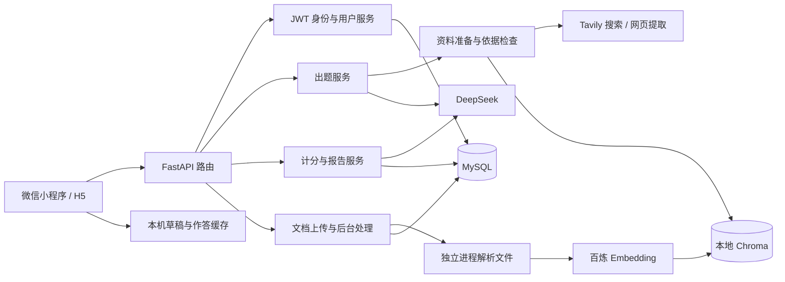

# 《学习咩 AI 闯关学习小程序》方案设计文档

这份文档解释当前代码怎样配合完成学习流程，便于阅读和维护。项目已经从纯文本 MVP 扩展到用户系统、联网资料和私有知识库，下文按实际实现说明，不再保留尚未采用的技术选型与拟议目录。

## 一、整体架构

前端同时编译到微信与 H5，使用同一套业务状态；后端提供 HTTP API，集中处理外部调用、身份、资料校验和持久化。MySQL 保存账号与学习记录，Chroma 保存私有文档的向量和检索片段。

后端使用 LangChain 提示词和模型适配；联网资料获取使用 LangChain `create_agent`。本仓没有独立的 `langgraph` 业务编排层，也没有 COS、生图服务和 Docker 文件，不照搬参考仓库的这些部分。

## 二、代码目录与职责

代码按已有边界组织，维护时优先修改对应模块。本次保留运行目录和导入路径，避免为了目录外观牵动现有功能。

| 目录或文件 | 负责什么 |
| --- | --- |
| `backend/app/main.py` | 创建应用，组装服务，注册路由和异常响应，管理资源释放 |
| `backend/app/routes/` | 学习、账号、知识库 HTTP 入口及登录要求 |
| `backend/app/models/` | API、资料、题库、报告和文档的数据类型与业务校验 |
| `backend/app/core/` | 配置、内容规则、JWT、响应、请求体和频率限制 |
| `backend/app/llm/`、`prompts/` | 模型调用、JSON 校验、重试与提示词 |
| `backend/app/services/` | 出题、搜索、依据检查、计分、报告、文档处理与 RAG |
| `backend/app/storage.py` | MySQL 连接池、升级、用户和学习记录存取 |
| `backend/app/repositories/knowledge.py` | 文档归属、状态和数量限制的数据库操作 |
| `frontend/src/pages/` | 首页、答题、报告、题库、我的、知识库六个页面 |
| `frontend/src/domain/` | 题库类型、计分、恢复、云端数据转换与文档数据校验 |
| `frontend/src/auth/`、`storage/`、`history/` | 账号、缓存、草稿、历史列表与订阅 |
| `frontend/src/services/` | API 请求、上传、学习会话和知识库页面状态 |
| `frontend/src/components/` | 页面外壳、来源展示、文件选择与公共控件 |

## 三、出题流程

先取得资料，再生成题目，可以让每道题关联实际片段。格式正确并不代表事实正确，因此有资料的题目还要进行独立依据检查。

1. 清理并校验输入，判断主题、正文或公开网页，按需要获取资料。
2. 有歧义时返回领域选项；前端保留原输入，加上 `topic_context` 重新提交。
3. 资料充分后，调用模型生成题干、选项、答案、讲解、知识点和来源关联。
4. 校验题量、题型与难度；随后逐题检查事实、答案、讲解和原文片段。未通过时最多修正一次，仍不通过就返回错误。
5. 登录用户先保存题库再返回，来源和生成方式随题库保存；游客由前端保存到当前设备。

资料准备默认 25 秒，出题及依据检查共享 25 秒，含保存的总请求最多 55 秒；前端等待 60 秒。外部工具最多四次，资料最多 12000 字符。预算来自配置，不能在内部另加无限重试。

### 私有文档的补充顺序

文档出题先校验登录、归属和就绪状态，再检索自己的文档。根据实际采用的资料记录生成方式，避免把模型题伪装成文档题。

| `generation.mode` | 实际使用的依据 |
| --- | --- |
| `document` | 文档片段 |
| `document_web` | 文档和网页 |
| `web_fallback` | 文档不足或不可用，改用网页 |
| `model_fallback` | 文档和联网资料仍不足或不可用；`reference=null`，保存未核实提示与原因 |

模型兜底只用于文档路径的资料问题。身份、归属、文档未就绪、内容违规、限流、依据审核失败、格式错误和保存失败仍返回错误。普通出题没有模型兜底。

## 四、答题、报告与保存

前端本地判题用于立即反馈，最终报告由后端重新计算，防止客户端统计影响账号经验。登录场景使用用户已保存的原题，重复提交同一报告不会重复增加 XP。

| 数据 | 保存位置 | 恢复规则 |
| --- | --- | --- |
| 游客草稿、题库、逐题作答、报告 | 当前设备 | 退出或刷新后可继续；清除设备数据会丢失 |
| 登录用户题库、最终作答、报告 | MySQL，并有本机缓存 | 同账号可从其他客户端回看最终报告 |
| 登录用户未完成进度 | 当前设备 | 换设备从第一题开始，不自动同步进度 |
| 文档元数据与处理状态 | MySQL | 按用户和文档归属访问 |
| 文档片段与向量 | 本地 Chroma | 删除文档时清理；历史引用快照保留 |

多选按集合完全一致判分，每题正确 10 XP。正确率采用四舍五入、半数向上；同一知识点只要有一题错，就归入待巩固，不同时列入已掌握。AI 负责总结、建议和鼓励语，不决定分数。

## 五、文档处理与资源管理

上传接受后先返回 `processing`，后台再解析、分块和向量化，前端轮询状态。文字解析在可终止子进程执行，含排队最长 180 秒；文件解析后删除，中间片段文件在成功或失败时清理。

文档状态为 `processing/ready/failed/deleting/delete_failed`。只有 `ready` 可出题；失败和未清理完成的文档仍占名额。删除先禁止检索，再等正在写入的任务结束并清理；失败可重试。重启后中断任务标为失败，不自动再次消耗向量化额度。

Chroma 使用本地持久化目录，只运行一个 API worker。备份时停止业务写入，同时备份 MySQL 与 Chroma；更换向量模型、维度或地域后需删除旧文档重传。

## 六、边界校验与错误处理

用户输入、HTTP 入参、外部模型和第三方响应需要校验；本机持久化缓存也需要检查版本与结构。内部函数按已有类型调用，非预期错误应暴露，避免多层判空与吞异常。

保留的容错包括：上游格式错误的有界重试、私网 URL 拒绝、微信响应校验、数据库事务回滚、账号切换后的迟到响应丢弃、旧题库缺少可选来源时继续可读。这些都有具体使用场景，不能为了“代码简洁”一并删除。

接口与错误码见[后端说明](../backend/README.md)，页面与跨端说明见[前端说明](../frontend/README.md)。需要复现与验证时，按[运行指南](保姆级本地运行指南.md)和[维护指南](项目维护指南.md)执行。
