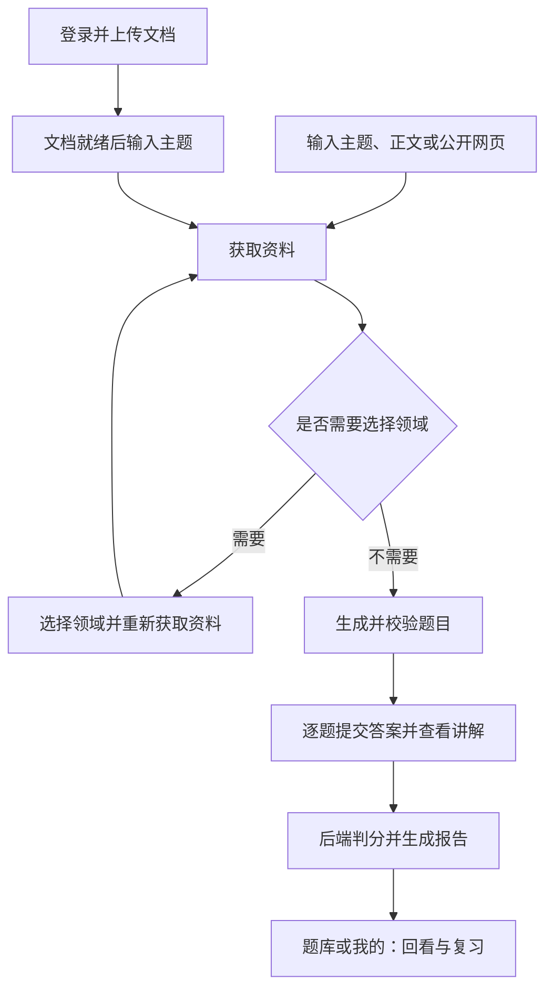

# 《学习咩 AI 闯关学习小程序》需求分析文档

### 人工需求分析

> 这是我人工确认后的，相对重要的需求，不要忽略

核心功能 MVP（按照用户操作的核心业务流程设计）：

1）用户可以自由输入一个他想学的知识（可以是一句话、一段话、甚至是一个文档 / 一个视频 / 一个网页）

2）AI 自动从全网或者特定的信息源获取知识（比如网络搜索，或者解析文档 / 视频 / 网页）

3）AI 自动生成交互式问答闯关的题目、选项和答案，通过提问引导来增加用户学习的趣味性

4）用户可以自由答题闯关，每道题目选择后立刻给出正确答案和知识讲解（答错也有知识讲解）

5）通关之后会生成一个知识总结和复盘报告，用户可以分享给好友

6）用户可以在后台分析自己所学的知识和答题情况，便于日后复盘，还可以生成报告

---

以下是需求分析文档正文：

## 一、需求背景

看完资料后，学习者往往不知道自己是否真的理解。学习咩让用户选一个小主题，通过一组题目主动思考，每题看讲解，最后根据报告决定下一步复习什么。

项目以微信小程序为主要入口，同时提供 H5 预览。默认一轮五题，优先让“输入 → 答题 → 复盘 → 再次回看”这条路径清楚、可恢复。

## 二、当前功能范围

用户可以先体验游客学习，再按需要登录保存云端记录、使用私有知识库。功能状态以源码和对应验收记录为依据，完成实现不等于已经完成真机发布验收。

| 模块 | 已实现的行为 | 使用限制 |
| --- | --- | --- |
| 主题输入 | 主题、正文、公开 URL；最多 2000 字符 | 私网链接、受保护网页和视频解析不支持 |
| 资料准备 | 检索与网页读取；歧义主题先返回 2～4 个领域选项 | 普通出题资料不足或检索故障时暂停并保留输入 |
| 题目生成 | 接口支持 3～5 题，前端默认五题；单选、多选、判断 | 格式、数量、难度及依据审核未通过时不交付题库 |
| 逐题学习 | 选择后提交，展示答案、讲解、知识点及参考来源 | 多选必须完整匹配；答对 10 XP，答错 0 XP，不扣分 |
| 报告复盘 | 正确率、答对数、XP、三句总结、薄弱点、建议与题目回看 | 后端重新判分，AI 不能修改统计结果 |
| 本机恢复 | 保存草稿、答案、位置和报告；失败可重试 | 未完成作答不跨设备同步 |
| 题库与个人中心 | 搜索、状态筛选、历史分页、昵称和学习统计 | 游客、本机账号缓存及云端账号分别管理 |
| 用户系统 | 微信登录、JWT、账号题库与最终报告保存 | H5 正式使用为游客；本机可显式启用测试账号 A/B |
| 私有知识库 | 登录上传 PDF/DOCX/MD/TXT，处理、查询状态、删除与文档出题 | 每人 10 篇、每篇 10MB；PDF 需有可提取文字，文本需 UTF-8 |

### 普通学习与知识库学习的区别

普通首页出题要求有充分资料，不会因为检索失败就默默改用模型知识。文档出题允许两级补充：先联网，再在资料仍不可用或不足时生成带警示的模型练习。

| 场景 | 用户看到什么 |
| --- | --- |
| 主题有多个含义 | 先选择领域，再重新获取资料 |
| 普通主题资料不足 | 提示补充领域、正文或公开链接，不生成题库 |
| 文档资料充分 | 生成题目，逐题展示文档片段和可用页码 |
| 文档不足，联网资料充分 | 显示实际采用的网页来源 |
| 文档与联网均不可用或不足 | 明确标注“模型生成，未依据文档或联网资料核实”，不伪造引用 |
| 登录、归属、文档状态或保存失败 | 返回对应错误，不转成一次成功的模型兜底 |

## 三、用户操作流程

用户先准备资料再答题，生成或报告失败时保留已有输入和作答。资料提示与恢复入口应让用户知道下一步可以做什么。

资料不足时按上表暂停或提示模型兜底；依据审核失败不能用模型兜底绕过。

## 四、数据与隐私要求

用户应能分辨哪些数据只保留在设备上、哪些送到云端。删除文档也不应让过去已经生成的题库和报告失去可读性。

1. 游客题库、作答和报告保留在本机；登录后的题库、最终作答与报告保存在 MySQL。
2. 切换账号立即隔离缓存，迟到响应不能写入另一个账号；游客历史不自动归入账号。
3. 文档片段送百炼向量化，选中的资料片段送 DeepSeek；联网查询只使用公开学习主题，不把私有文档原文作为搜索词。
4. 原文件解析后删除，向量与片段保存在本地 Chroma；删除文档后，既有题库、报告和引用快照保留。
5. API Key、数据库密码和微信 AppSecret 只保存在后端环境中；接口和日志不回显原始密钥或上游错误正文。

## 五、验收与后续方向

改动后优先验收一条完整学习路径，再检查与本次改动相关的降级。自动化验证方法见[维护指南](项目维护指南.md)，历史真实调用和模拟器结果见[验收记录](验收记录/README.md)。

当前不包含视频解析、OCR、文档文件夹、AI 配图、语音、分享海报、排行榜、好友 PK、付费或发布部署方案。后续可以在现有题库与报告基础上增加错题复习、学习提醒和更细的统计；这些方向需要另行确认需求。

用户系统专题见[用户系统需求](用户系统需求分析文档.md)。当前行为见 `openspec/specs/`；知识库已同步并完成归档，实施依据见[知识库变更](../openspec/changes/archive/2026-10-30-add-private-knowledge-base-rag)。
