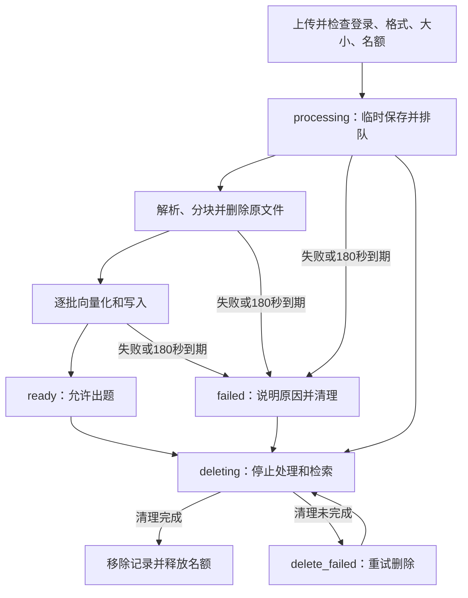
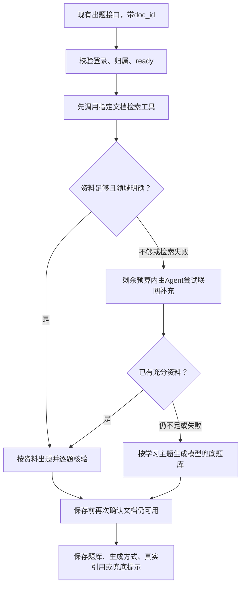

# Design

## Context

本文保留接入知识库前的设计背景；下文“旧归档”指从 yu-ai-learn 复制、现存于本机 `.local/reference-openspec/` 的参考资料，不指本项目自己的已完成变更。当前实现、主规范同步和归档状态见文末验收说明。

本方案解决什么问题见 [proposal.md](proposal.md)。这里以当前代码为接入基线，归档中的“任务已完成”不代表这些接口已经存在于当前版本。

| 已核对的当前位置 | 对设计的影响 |
| --- | --- |
| `backend/app/routes/api.py` 的同步 `/quiz/generate` | 继续用此入口；当前没有 `/quiz/generate/async`、`quiz_tasks` 或出题轮询 |
| `services/quiz.py`、`services/search.py`、`services/evidence.py` | 已有资料准备、领域确认、原文依据核验；复用主流程，仅给文档分支增加有标识的兜底 |
| `models/knowledge.py` | 现在是网页/正文依据模型，不能覆盖文件同名模型；新增文件模型放 `models/document.py` |
| `storage.py`、`sql/001_users.sql`、`scripts/init_db.py` | 连接池按需连接，迁移由命令执行；不采用归档中的启动自动建表和存储失败静默成功 |
| `core/middleware.py`、`main.py` | 默认所有 POST/PUT 只接受 64KiB，且 CORS 未允许 DELETE；上传需要单独的流式限额 |
| 前端 `domain/learning.ts`、`QuestionReferences.tsx` | 目前只认可 `web/user_text`，新增文档来源和兜底字段必须同步修改校验与回看 |
| 前端 `auth/store.ts`、`storage`、`cloud-session.ts` | 已有账号分区和迟到响应处理，新上传和轮询沿用相同规则 |

当前锁文件包含 LangChain 1.4.7、LangGraph 1.2.18、langchain-deepseek 1.1.1；前端是 Taro 4.3.1、React 18。以上是仓库记录，不代表本轮已安装、构建或进行真实服务联调。

## Goals / Non-Goals

设计重点是把上传、资料准备和出题接在已有学习流程上，并让用户分辨“依据资料出题”和“模型兜底”。登录、大小和数量等确认结果详见提案及三份差量规范。

**Goals:**

- 文档归属、处理状态由 MySQL 管；片段和向量由本地 Chroma 管，重启后就绪文档仍可用。
- 资料失败按用户确认顺序降级，但不能借此绕过身份、文档状态、内容规则或保存错误。
- 文档上传异步处理，出题继续同步；每段等待都计入已确认的总期限。
- 原文件及时清理；生成方式、依据摘录随学习历史保存，不依赖原文档仍存在。

**Non-Goals:**

- 本期不做 OCR、旧版 DOC、在线文件预览、全文下载、跨文档检索、文档共享或替换更新。
- 本期不增加 COS、图片生成、付费额度系统、分布式任务队列或多实例 Chroma 部署。
- 不改现有计分、XP、报告生成接口及主页面切换行为；H5 登录继续使用已有能力，不新增网页登录体系。

## Decisions

### 1. 使用原生 Chroma API，保持检索与业务权限清楚

选择 `chromadb.PersistentClient` 本地持久化，由后端显式提供向量。Chroma 官方支持关闭默认 Embedding 函数、按 metadata 查询和删除，因此无需再套一层向量库适配。[Chroma 集合管理](https://docs.trychroma.com/docs/collections/manage-collections)、[集合 API](https://github.com/chroma-core/chroma/blob/main/docs/mintlify/reference/python/collection.mdx)。

- 一个用户、同一 Embedding 配置使用一个 collection，例如 `kb_u_123_v4_1024_v1`。配置标识包含模型、维度和地址/地域配置的非敏感版本号，不含密钥。
- 每段保存 `user_id/doc_id/chunk_id/file_name/chunk_index`；PDF 另外保存从 1 开始的 `page`，其他格式不编造页码。没有页码时不往 metadata 写空值。
- collection 设置 `embedding_function=None`；写入显式传 `ids/documents/metadatas/embeddings`，查询显式传 `query_embeddings`。禁止让 Chroma 默认下载并使用另一套本地模型。
- 查询和删除均带固定过滤：`{"$and":[{"user_id":{"$eq":"123"}},{"doc_id":{"$eq":"..."}}]}`。账号来自已验证 JWT，文档来自已校验记录，不由 Agent 工具参数传入。
- MySQL 的 `ready` 是检索入口。向量已写了一部分不代表文档就绪；失败和删除状态在入口被拒绝。
- 一套配置只写固定维度；更换模型、维度或地域配置不能把旧向量拿来与新向量比较，应提示旧文档需要删除重传。该次资料获取可按既定顺序降级。

备选 `langchain-chroma` 也能完成集成，但本期只有写入、限定检索和删除三种调用，原生 API 更直接。独立 Chroma Server 便于多进程部署，但增加运行依赖，本期不选。

### 2. 百炼 Embedding 使用现有 HTTP 客户端，明确批量与地域配置

继续选归档使用的 `text-embedding-v4`，默认 1024 维。官方仍提供 OpenAI 兼容 Embedding 接口；本项目已有 `httpx`，可以直接发送字符串数组，避免额外 SDK 的默认分词、重试和批量参数影响请求。[百炼同步 Embedding API](https://help.aliyun.com/zh/model-studio/text-embedding-synchronous-api)。

| 项目 | 设计 |
| --- | --- |
| 请求 | `POST {DASHSCOPE_BASE_URL}/embeddings`，Bearer Key；JSON 含 `model/input/dimensions/encoding_format="float"` |
| 当前官方地址示例 | 北京地域 `https://{WorkspaceId}.cn-beijing.maas.aliyuncs.com/compatible-mode/v1`；实施者填真实业务空间并匹配 Key 地域，不直接照抄归档旧域名 |
| 批量 | v4 官方最多 10 条，本期默认每批 2 个片段，每段约 1000 字符；按剩余处理时间逐批请求，不把整篇文件一次发送 |
| 响应校验 | 在外部边界检查条数、索引、维度和有限数值，保证输入与返回向量逐一对应 |
| 超时 | 单次 Embedding HTTP 最多 10 秒，且不超过当前阶段剩余时间；不使用 SDK 隐式重试 |
| 密钥 | 只从后端配置读取，不返回前端，不写日志和 collection metadata |

官方接口说明对 v4 给出单条 8192 Token 上限，不同页面/地域的批次 Token 描述有差异，不能把字符数当成精确 Token 数。1000 字符的小块与每批两段是保守实现选择；若仍被服务拒绝，任务明确失败，不静默截断。此处不承诺吞吐、免费额度或实际收费金额。

备选 `OpenAIEmbeddings` 和 DashScope 专用 SDK 都可用，但需要额外处理兼容接口默认参数，当前直接 HTTP 调用足够。真实 Key、业务空间、模型权限及 Windows 可安装版本须在实施时核验；本轮没有发起付费调用。

### 3. 轻量提取文字，解析完成即删除原文件

PDF、DOCX 用各自的小型库，Markdown/TXT 直接读 UTF-8（兼容 BOM）。不需要为这四类文件引入 `langchain-community` 或 `unstructured`。[pypdf 文字提取](https://pypdf.readthedocs.io/en/stable/user/extract-text.html)、[docx2txt 官方用法](https://github.com/ankushshah89/python-docx2txt)、[递归分块与中文分隔符](https://docs.langchain.com/oss/python/integrations/splitters/recursive_text_splitter)。

| 格式 | 提取方式 | 真实边界 |
| --- | --- | --- |
| PDF | `pypdf.PdfReader` 按页 `extract_text()` | 保留页码；无文字层、需要密码、损坏文件明确失败；不新增 OCR |
| DOCX | `docx2txt.process()`，不提取图片 | 保留文字顺序；不保证复杂表格还原，也不声称知道 Word 页码 |
| MD/TXT | 标准库读 `utf-8-sig` | 不渲染 Markdown、不执行其中代码；解码失败提示改存 UTF-8 |
| 统一分块 | `RecursiveCharacterTextSplitter`，1000 字符、重叠 150 | 优先按段落、换行和中英文标点切分，保留顺序标识 |

上传原文件存入受控临时目录，文件路径只用服务器生成的 UUID 和白名单扩展名；原文件名仅作为显示数据。解析输出到该文档的临时片段文件后，先删除原文件，再进行向量化；完成、失败和超时都清理中间文件。解析出空白内容不能变成 `ready`。

同步解析放在可终止的独立解析进程，使用当前 Python 环境运行一个专用解析模块，Windows 也走同样入口。进程只接触该文档的临时文件，不连接 MySQL、Chroma 或模型；到期时终止并等待退出，再清理文件。仅使用 `asyncio.to_thread` 做解析的备选不能停止卡住的解析工作，因此不用于保证 180 秒期限。

### 4. 用小型后台处理流程管理状态，不恢复旧的异步出题系统

文件处理需要异步，题库生成仍在当前同步接口内完成。上传接受后创建有引用管理的后台任务；应用关闭时停止任务、解析进程和自己创建的 HTTP 客户端，不使用没有管理的 `create_task`。[FastAPI 文件上传](https://fastapi.tiangolo.com/tutorial/request-files/)。

- 180 秒从接受上传并写入记录开始计算，包含排队；后台最多并行处理两篇，队列中的文档也有到期管理，不能无限等待。
- 状态更新有条件，例如仅 `processing` 能改成 `ready`；删除先改状态，阻止迟到任务重新就绪。
- Chroma 的同步磁盘操作放到受控线程执行，文档级锁串行化该文档的写入和清理。取消 Python 等待不能停止已进入原生库的写入；因此失败/删除先在 MySQL 禁止检索，等待已发出的写入结束后再清理，不让清理跑在迟到写入之前。
- 失败处理先发布 `failed`，再清理部分向量；未清完保留 `cleanup_pending`，不能把磁盘清理耗时算成还在正常处理。清理状态可重试，不对外承诺文件系统故障时也能瞬间清空。
- 后端恢复后把中断的 `processing` 标为 `failed`，不自动重新收费处理；继续 `deleting/delete_failed/cleanup_pending` 的清理，并移除未关联记录的过期临时文件。
- 恢复与清理后台任务每 30 秒检查一次；数据库不可用时保留记录并稍后重试，不阻止游客普通学习启动。无密钥或知识库存储配置不可用时，新上传返回配置不可用，不接受后再假装成功。

备选独立任务队列可以在多实例中恢复任务，但当前只有单 worker、小文件和有限文档数量，不为本期增加这套系统。MySQL 记录和重启失败提示足以避免任务永远停在处理中。

### 5. 文档检索、联网和模型兜底按固定顺序协作

复用现有 `langchain.agents.create_agent`、DeepSeek、Tavily 工具和调用限制，不使用归档中的 `langgraph.prebuilt.create_react_agent`。LangChain 官方 v1 迁移文档已推荐当前接口，LangGraph 作为现有底层依赖继续使用。[LangChain v1 迁移](https://docs.langchain.com/oss/python/migrate/langchain-v1)。

`services/rag.py` 提供文档资料准备入口，首个 `search_knowledge_base` 工具调用由服务明确执行，不能仅靠提示词要求“优先”。工具闭包固定用户和文档；默认返回最相关 4 段，并以真实片段建立 `s1` 等来源。

接入点放在当前 `routes/api.py`：带 `doc_id` 时先要求身份并取得已授权的就绪文档，再把该内部文档对象传给 `QuizService.generate`；未传时维持现在的可选身份和资料入口。RAG 准备结果明确区分有依据、待确认领域和模型兜底，不构造没有来源的 `PreparedKnowledge(status="ready")` 来骗过现有校验；只有有依据结果进入现有依据出题路径。

文档检索及其充分性判断最多占资料准备阶段的 8 秒，余下时间留给联网。不足时 Agent 可在剩余预算内改写检索主题或使用 Tavily；文档检索也计入总工具次数，最多 4 次，Agent 模型调用最多 5 次，所有判断均计入资料准备的 25 秒。工具返回内容由服务收集，Agent 自己写的总结不能冒充原文依据。

文档及网页片段合计最多 5 项，每项摘录最多 2000 字符，序列化上下文最多 12000 字符。相关性不足、没有内容、Embedding/检索的已知服务故障或超时可触发下一步；预算耗尽不再启动新检索。联网关闭或未配置时，如文档也不足，直接进入模型兜底并记录原因。

实施审查补充：首次文档判断不足后最多保留前三个候选，为两份独立网页资料留位；Agent 重新检索文档时可替换旧私有候选并重新编号，不能让已判不足的片段永久占满五个位置。原生写入的完成等待也必须抵御超时、删除和关闭带来的重复取消，持锁到真正完成后才能清理。

真实联调补充：首次文档检索不可用时，Agent 只拿公开资料工具，不反复重试已失败的文档服务。首次检索成功但不足时允许私有重试；重试遇到已知外部故障只返回明确失败提示，让同批联网任务继续。内容、权限和非预期内部错误仍抛出，不靠模型兜底绕过。

联网工具只接收用户学习主题及确认领域，不直接接收文档摘录、文件路径或原文件。工具参数在服务边界限制，不能把完整私有内容交给 Agent 自由拼成搜索参数。搜索结果继续使用当前公开 URL、来源、时效和充分性检查；网络资料与文档有冲突时不强行拼成“已核实”题库。

有资料依据时复用 `GroundedQuizContent`、现有 Prompt 和 `EvidenceService`。资料已充分但题目审核失败时最多修正一次，仍不通过就返回错误，不能通过切换模型模式逃避这项审核。领域仍有歧义时继续返回现有 `40902` 选项，用户选择后重走文档流程。

模型兜底使用独立 Prompt 和现有 `QuizContent`，只接收用户主题、难度和题量，不把失败的资料当成已核实上下文。仍通过结构、数量、题型、难度和内容检查；没有真实资料，便不调用原文核验来制造“已核实”结论。模型缺少配置、调用失败、非法输出重试耗尽或请求已到期时正常报错，降级并不保证每次成功。

只转换已知的资料获取故障为降级结果；权限、状态、内容规则、429、JSON 入参、数据库写入错误和非预期内部异常继续按既有方式抛出。内部模块信任已校验类型，不散落判空或用宽泛异常捕获掩盖错误。

### 6. 将实际生成方式与引用一起保存，兼容旧记录

仅靠 `reference=null` 无法区分“旧数据没有来源”和“本次明确进入了模型兜底”。因此题库增加可空 `generation`，同时把文档来源加入现有引用模型；保留现有 `source_type="text"`，避免无必要地改动计分和历史记录流程。

| 字段 | 约定 |
| --- | --- |
| `generation.mode` | `document/document_web/web_fallback/model_fallback`，由实际被采纳的来源类型确定，不由模型自报 |
| `generation.doc_id/doc_name` | 本次选择的文档 ID 和文件名快照；文档删除后仍可解释历史 |
| `generation.reason` | 文档降级原因枚举或空值，例如 `document_insufficient/document_unavailable/web_insufficient/web_unavailable/preparation_timeout` |
| `generation.message` | 后端根据方式和原因生成的安全短说明；模型兜底固定包含“模型生成，未依据文档或联网资料核实” |
| `reference.sources[].kind` | 扩展为 `web/user_text/document`；文档项有 `doc_id/chunk_id/page?`，仍用 `id/title/excerpt` 及空的 URL/发布日期 |
| `reference.question_sources` | 有资料依据时继续每题至少一个真实来源；模型兜底时整个 `reference=null`，不放空来源伪装通过校验 |

例：文档充足为 `document`；最终依据同时含文档和网页为 `document_web`；文档失败后仅网页足够为 `web_fallback`；两者均无法支持出题为 `model_fallback`。尝试过联网但最终没有采用其内容，不标成文档加联网。

新增 `sql/003_knowledge_base.sql` 管理文档表及 `quiz_sessions.generation JSON NULL` 迁移，沿用 `initialize_schema` 查询列是否存在后再执行的方式，重复运行不丢数据。文档字段建议如下，不把完整正文再复制一份到 MySQL。

| 字段组 | 内容 |
| --- | --- |
| 身份 | `doc_id` UUID 主键、`user_id` 外键；`(user_id,created_at,doc_id)` 索引 |
| 文件显示 | `file_name/file_type/file_size`，只保留清理后的显示名，不存用户提供的路径 |
| 处理 | `status/chunk_count/embedding_profile/error_code/error_message` |
| 清理和期限 | `cleanup_pending/created_at/updated_at/deadline_at`，临时路径由 UUID 推导 |

接受上传时，在短事务中锁定该用户行、重新统计尚未移除记录数并插入记录，解决两次并发上传同时通过额度检查的问题。事务不包住文件解析、Embedding 或模型调用。临时保存后插入失败要清理文件；进程崩溃留下的无记录文件由恢复清理处理。

新增独立 `KnowledgeRepository` 使用现有 `Database`，不把文件业务硬塞进 `UserRepository`。题库生成信息由现有题库保存/详情方法读写；前端的类型、`isQuiz`、来源校验、本机恢复和云端转换必须同时更新，旧数据缺少 `generation` 继续接受。

删除状态与保存题库使用同一文档行作为最后的检查依据：保存前短事务锁行并确认仍为 `ready`，再保存题库；删除先锁行变成 `deleting`。先完成保存的题库属于已生成历史，之后删除不追溯；删除先发生则不再成功保存。模型调用期间不持有行锁。

### 7. 接口与上传边界

知识库接口全部要求 `required_identity`，失败使用现有 `code/message/data` 信封。出题仍保留现有成功响应及 `X-Learning-User`，只有保存到该账号后才返回身份头。

| 接口 | 输入 | 成功结果 |
| --- | --- | --- |
| `POST /api/v1/knowledge/documents` | `multipart/form-data`，单文件字段 `file`；可选 `file_name` 保留微信原名，最多 255 字符，继续按同样规则清理与解析 | HTTP 202，文档项含 `doc_id/status=processing` |
| `GET /api/v1/knowledge/documents` | 无；本期最多 10 篇，无需分页 | HTTP 200，`data.items` 为文档列表，附 `limit=10/max_file_bytes=10485760` |
| `GET /api/v1/knowledge/documents/{doc_id}` | 本人的文档 ID | HTTP 200，文档项含状态、片段数、失败提示、UTC 时间 |
| `DELETE /api/v1/knowledge/documents/{doc_id}` | 本人的文档 ID | HTTP 202，`{doc_id,status:"deleting"}`；完成后 GET 为 404，删除失败仍能读到 `delete_failed` |
| `POST /api/v1/quiz/generate` | 现有字段加可选 `doc_id` | HTTP 200，完整 Quiz，文档请求附 `generation` |

上传中间件只对上述上传路径使用 11MiB multipart 请求上限，并按流累计读取大小，不把整个请求拼成 `bytearray`；其他 JSON 路径保持 64KiB。超过流上限要返回受控 413，包括未给 `Content-Length` 的请求；路由再按实际文件字节执行 10MiB 限制，multipart 余量不等于放宽文件大小。[FastAPI UploadFile](https://fastapi.tiangolo.com/tutorial/request-files/)。

`UploadFile` 逐块复制到受控目录并关闭请求临时句柄，后台任务只接手自己保存的文件，不能继续使用请求结束时已关闭的 `UploadFile`。扩展名不区分大小写；是否真能读取由实际解析器确认，不只信任客户端 MIME。

沿用当前限流配置，将上传纳入同一每 IP 频率保护，不增设每日次数额度；GET 轮询不消耗 AI 请求额度。CORS 增加 DELETE，继续允许 Authorization。认证错误用 `40101`，未找到沿用 `40401`，文件/请求大小用 `41301`，文件格式/空文字等输入问题用 `42201` 或文档状态的安全失败提示；文档未就绪和名额用独立的 `40903/40904`，存储和服务故障沿用安全 503。实现前核对这些新增业务码未被其他功能占用。

### 8. 双端交互与首个样品

新增 `pages/knowledge/index` 作为“我的”的下级页面，返回个人页，保留原有三个主导航和页面动效。微信使用 `Taro.chooseMessageFile`，H5 使用原生文件 input；官方支持表未给 `chooseMessageFile` 提供 H5 实现。[Taro 文件选择](https://docs.taro.zone/docs/apis/media/image/chooseMessageFile)、[Taro 文件上传](https://docs.taro.zone/docs/apis/network/upload/uploadFile)。

- 微信通过 `Taro.uploadFile` 传字段 `file` 和 Authorization，并在 `formData.file_name` 携带选择器提供的原文件名；平台的 `fileName` 选项不支持微信，不能依靠临时路径保留原名与扩展名。返回的 `data` 是 JSON 字符串，需在网络边界解析并校验。不要复用强制 JSON Content-Type 的现有 `send` 上传文件。
- H5 用文件 input 和 `FormData`/`fetch`，让浏览器生成 multipart boundary，使用 `AbortController` 处理页面取消；不依赖 `UploadTask.abort` 的 H5 支持。
- 双端上传等待最多 60 秒，上传成功后再轮询后台处理；60 秒上传等待不等于 180 秒后台处理期限。网络失败结果不明时先刷新列表，避免页面自动重传造成重复文档和收费。
- 页面说明支持格式、10MB、10 篇及失败记录仍占名额。处理中禁用“开始闯关”；失败可删除重传；删除失败可重试删除。
- 就绪文档默认以去掉扩展名的文件名作为学习主题，允许用户修改后“开始闯关”；请求始终提交现有的非空 `user_input`。文件名含义不明时引导补充具体主题；模型兜底不能承诺已了解未成功检索的文件内容。
- 文档状态每 2 秒查询一次，仅页面可见且存在未完成状态时轮询；隐藏、卸载、退出或换账号停止轮询并丢弃迟到响应。重新打开从后端读取，不依赖本机轮询仍在运行。
- 账号切换时对上传、生成及状态调用使用请求开始时的账号快照，复用当前 scope 检查。服务器若已接受上传，停止前端等待不等于删除服务器文档；回原账号可继续查看。
- `model_fallback` 在第一题作答前及每题讲解处显示固定未核实提示；文档加网页和网页兜底也说明实际方式。报告顶部及题目回看继续显示生成方式，原有统计与报告接口不改。

首个样品先打通“登录 → 中文 TXT 上传 → ready → 五题闯关”并演示未核实提示，使用受控测试边界时明确标注模拟数据。用户已确认入口、顺序与提示清楚，沿用当前布局和文案。双端页面已实现，真实云端联合体验与最终人工验收另行记录。

实施审查补充：上传或删除开始时，使较早的列表请求失效，操作后重新读取，防止旧列表恢复已删除文档。领域确认所选文档消失或不再就绪时清除选项，点击领域入口也检查文档仍可用。

### 9. 配置和运行方式

所有新增目录使用以 backend 根目录为基准的绝对解析路径，避免启动工作目录变化使向量库写到别处。Chroma 官方说明嵌入式本地目录不支持多进程并发写入，因此本期运行一个 API worker；解析子进程不接触 Chroma。[Chroma 运行约束](https://cookbook.chromadb.dev/core/system_constraints/)。

| 配置 | 默认或要求 |
| --- | --- |
| `DASHSCOPE_API_KEY` | 必须配置才能接受新文档，不回显 |
| `DASHSCOPE_BASE_URL` | 按官方文档填写匹配业务空间及地域的地址，无可直接运行的假默认地址 |
| `DASHSCOPE_EMBEDDING_MODEL` / `KB_EMBEDDING_DIMENSIONS` | `text-embedding-v4` / `1024` |
| `CHROMA_PERSIST_DIR` / `KB_UPLOAD_DIR` | `backend/data/chroma` / `backend/data/uploads`，排除 Git 并限制访问 |
| `KB_MAX_DOCUMENTS_PER_USER` / `KB_MAX_FILE_SIZE_MB` | `10` / `10` |
| `KB_PROCESS_TIMEOUT_SECONDS` / `KB_RETRIEVAL_TIMEOUT_SECONDS` | `180` / `8`，后者不能大于资料准备总预算 |
| `KB_CHUNK_SIZE` / `KB_CHUNK_OVERLAP` / `KB_RETRIEVE_TOP_K` | `1000` / `150` / `4` |
| `KB_EMBEDDING_BATCH_SIZE` / `KB_PROCESS_CONCURRENCY` | `2` / `2`；批量不可超过所选模型 API 限制 |
| 现有知识/出题配置 | 25 秒准备、25 秒出题、55 秒全请求，前端 60 秒；继续最多 4 次工具调用和 12000 字符上下文 |

不能用给每个阶段各自 55 秒的方式叠加等待。正常路径为资料最多 25 秒、出题及审核最多 25 秒，并为检查和保存留余量；外层 55 秒始终生效。查询文档的 Embedding 调用也受 8 秒检索预算约束，不能仅遵守上传时的 10 秒 HTTP 超时。

## Risks / Trade-offs

用户明确选择了可用性优先的模型兜底，因此“成功生成”不再总等于“有资料核实”。以下限制需要在验收时真实呈现，不能用通过结构测试代替题目质量判断。

| 风险 | 处理方式 |
| --- | --- |
| 模型兜底可能答错、过时或偏离私有文档 | 答题前、讲解、报告均提示未核实，保留原因；不伪造来源和最新事实保证 |
| 文件名不能准确说明学习目标 | 允许修改默认主题；领域不明继续确认，不声称模型已经读懂上传内容 |
| 私有资料需发送给外部 AI 服务 | 上传提示说明文字片段送百炼向量化、检索片段送 DeepSeek 出题；Tavily 只收学习主题，原文件不公开 |
| 10MB 文字文档仍可能很多、180 秒未必处理完 | 小批次、两个并行任务、完整期限和明确失败；不承诺每个 10MB 文件都能在三分钟内就绪 |
| 文件或向量清理可能遇到磁盘故障 | 先禁止检索，保留失败和清理标记，自动或手动重试；不丢失清理依据 |
| Windows 安装与 Chroma 原生组件兼容 | 实施时在 Python 3.11 环境安装并锁定可用依赖、执行真实本地持久化测试；不能沿用旧归档“纯 Python 无风险”的结论 |
| 多 worker 同写本地 Chroma | 本期明确单 worker；以后需要水平扩展时另做 Chroma Server 变更，不让多个进程共用目录 |
| 旧前端不识别文档来源或兜底字段 | 新旧前后端配套上线；保留旧题库读取能力，回滚时暂时隐藏知识库入口 |

## Migration Plan

实施时先在独立测试库和临时向量目录验证迁移，再部署配套前后端。当前已安装锁定依赖，并通过显式初始化命令升级本机应用数据库；真实环境文件与密钥未改写。具体结果见[验收记录](../../../../docs/验收记录/README.md)。

1. 在 `requirements.in` 声明直接依赖，解析并更新 Python 3.11 锁文件，检查与已有 LangChain 依赖兼容；无需改为 ChatOpenAI 或新增向量适配 SDK。
2. 配置真实百炼地址与密钥、可写持久化目录，保证 MySQL 与 Chroma 的备份分别可用。关闭业务进程后一起备份数据与向量目录，避免只备份其中一份。
3. 扩展现有 `python -m scripts.init_db`，创建 `kb_documents`，为 `quiz_sessions` 增加可空 `generation`。不删除现有题库，不修改 XP 数据，不在 API 启动时自动建表。
4. 部署一个 worker 的后端及配套前端，启动恢复清理；验证 TXT 完整学习、四格式上传、两级降级、超时、删除和账号切换。
5. 配置缺失时知识库给出明确不可用提示，普通游客学习继续按原规范工作。真实 AI 验收单独安排并记录，不把模拟响应当真实服务结果。
6. 回滚优先隐藏知识库入口并停接新文档，等待/停止处理后备份，再配套回退代码。保留新增列、表和向量目录，不自动删数据。旧客户端遇到已生成的文档来源数据可能无法显示，回滚不承诺旧客户端完整展示新题库；恢复新版本后仍可读取。

## Review and Acceptance

先审阅本文件的第 5、6、8 节，确认降级含义、保留数据和界面提示符合预期。以下是联合验收方法；代码、自动化、真实云端调用及用户授权的代理体验验收已完成，结果以[验收记录](../../../../docs/验收记录/README.md)为准。主规范同步与归档已于 2026-10-30 按用户明确指令完成，正式环境与真机的剩余验证不因归档而视为通过。

| 步骤 | 你要做什么 | 应该看到什么 |
| --- | --- | --- |
| 1 | 在微信或 H5 登录测试账号，从“我的”进入知识库 | 格式和额度说明、空列表、上传入口 |
| 2 | 上传有足够正文的中文 TXT，再分别上传 PDF/DOCX/MD | 先处理中，完成后就绪；无文字层 PDF 显示失败原因 |
| 3 | 从就绪文档以明确主题开始闯关，完成五题 | 有真实片段来源，正常计分，报告可回看来源 |
| 4 | 在受控验收环境让文档检索失败而联网正常 | 尝试联网，成功后标记网络依据或文档加网络，不伪装成纯文档题 |
| 5 | 再让联网不可用，保持模型正常 | 仍能生成完整练习，作答前和报告均显示未核实及原因 |
| 6 | 从云端或本机重开题库，随后删除原文档 | 生成方式/摘录保留，文档不能再被检索，题库和报告仍能回看 |
| 7 | 切换另一账号；尝试第 11 篇、超过 10MB、处理中开始闯关 | 不显示旧账号资料，超额和未就绪请求明确拒绝 |
| 8 | 让处理超过 180 秒或处理中重启；模拟一次清理失败 | 处理到失败终态；删除失败可重试，迟到结果不会恢复文档 |

失败反馈请说明步骤编号、预期与实际结果，并保留页面提示或服务端安全业务码。任务与自动化结果见 [tasks.md](tasks.md)；最终人工验收通过前不提前同步主规范或归档。

## Official References

外部技术资料于 2026-10-30 通过 Context7 和 Firecrawl 核对，关键限制已在对应决策旁引用。后续实施应再次核验所安装版本与账号所属地域，不能将文档示例视为真实 Key 或已完成联调的证明。

- [百炼同步 Embedding API](https://help.aliyun.com/zh/model-studio/text-embedding-synchronous-api)：兼容入口、v4 模型、维度与批量输入。
- [LangChain v1 迁移](https://docs.langchain.com/oss/python/migrate/langchain-v1)：使用 `create_agent`。
- [Chroma collection API](https://github.com/chroma-core/chroma/blob/main/docs/mintlify/reference/python/collection.mdx) 与 [运行约束](https://cookbook.chromadb.dev/core/system_constraints/)：显式向量、按条件操作及本地多进程限制。
- [pypdf 提取文字](https://pypdf.readthedocs.io/en/stable/user/extract-text.html)、[docx2txt](https://github.com/ankushshah89/python-docx2txt)、[递归文本分块](https://docs.langchain.com/oss/python/integrations/splitters/recursive_text_splitter)：格式处理及中文分块。
- [FastAPI 上传](https://fastapi.tiangolo.com/tutorial/request-files/)、[Taro 文件选择](https://docs.taro.zone/docs/apis/media/image/chooseMessageFile)、[Taro 文件上传](https://docs.taro.zone/docs/apis/network/upload/uploadFile)：multipart 和跨端差异。
