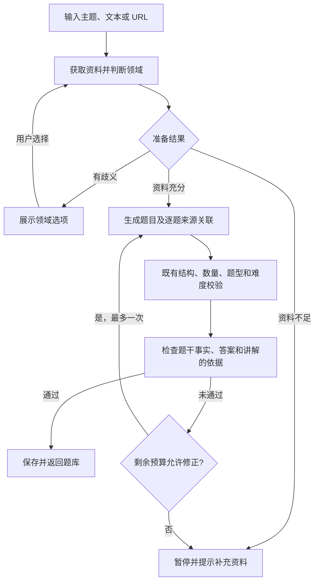

# Design

## Context

变更动机见 [proposal.md](proposal.md)。当前实际链路为：

`POST /api/v1/quiz/generate` → `QuizService.generate` → `ReliableGenerator` → `DeepSeekProvider`。

- 后端使用 FastAPI、Pydantic v2、`langchain-core` 和 `langchain-deepseek`；出题已有结构校验、题型数量校验和重试。
- 前端使用 Taro 4.3.1、React 18、TypeScript；首页通过同步请求生成题库，请求超时为 60 秒，已有取消与账号切换保护。
- 登录用户的题库存入 MySQL，游客记录存于本机；当前均未保存参考来源。
- 归档记载过联网搜索和知识库实现，但当前代码没有相应服务、工具或异步任务接口。用户已确认以当前代码为基线，本次只补齐联网搜索、网页读取和出题质量控制。

现有长期规范中的两份知识库 spec 缺少新版 CLI 要求的 `Purpose`，`list --specs` 因此显示 0 条要求，JSON 概览也报错。已直接完整读取原文确认内容；本次不借此删除或重写既有规范，仅提供必要的行为差量，格式修复留在实施后的规范同步步骤。

## Goals / Non-Goals

**Goals:**

- 将知识获取、领域判断、出题、依据检查拆开，复用现有生成与校验能力。
- 以“资料足够且领域明确”作为出题前提，不能用空摘要触发模型知识兜底。
- 保留可追溯的来源和逐题关联，并让历史记录继续可用。
- 在现有同步请求预算内完成处理，超时就清楚提示失败。

**Non-Goals:**

- 不恢复知识库上传、向量检索或异步任务队列。
- 不增加通用聊天、人工审核后台或长期网页缓存。
- 不调整模型选型、计分规则或报告接口，不承诺联网后所有事实绝对正确。

## Decisions

### 1. 知识获取：沿用 Agent + Tavily，两阶段保持解耦

**选择**：新增 `app/services/search.py`，通过 `langchain.agents.create_agent` 编排知识获取，工具使用 `langchain-tavily`，模型沿用 `ChatDeepSeek`。

| 工具 | 用途 | 固定配置 |
| --- | --- | --- |
| `tavily_search_basic` | 查找主题含义、定位来源 | `max_results=3`、`include_raw_content=False` |
| `tavily_search_deep` | 获取更充分的出题依据 | `max_results=5`、`include_raw_content=True` |
| `tavily_extract` | 读取用户指定的公开网页 | `extract_depth="basic"`，一次最多 3 个 URL |

两个搜索实例均固定 `include_answer=False`，不将搜索服务生成的 AI 答案当作原始资料。`query`、`search_depth`、`time_range`、域名过滤由 Agent 按需选择，不把所有主题都限定为最近一周。

工具通过应用包装层收集原始结果，分配来源 ID，保留正文片段及元数据。Agent 的最终摘要仅用于整理知识，不是事实来源；模型不能自行添加未检索过的 URL。

**理由**：输入可能是主题、文本、URL 或混合内容，工具选择适合由 Agent 完成；来源收集和质量门槛由程序控制，避免出题链直接承担不稳定的工具交互。

**备选方案**：全部手写搜索分支会增加多种输入的维护成本；沿用归档中的旧 `create_react_agent` 和文件路径则与当前代码、当前 API 不一致。

### 2. 先判断领域和资料是否够用，再出题

**选择**：新增 `app/models/knowledge.py`，知识准备结果只有三种状态：

| 状态 | 含义 | 后续动作 |
| --- | --- | --- |
| `ready` | 领域明确，资料足以覆盖本次题量 | 进入出题 |
| `clarification` | 存在 2～4 个有检索依据的合理含义 | 返回领域选项 |
| `insufficient` | 资料不足、存在关键冲突或无法确认时效 | 提示重试或补充资料 |

判定规则：

1. 学习主题需要检索；用户提供 URL 时先读取指定页面，不能读取失败后假装已阅读。
2. 用户贴出的完整学习文本也可作为来源，但必须标记为“用户提供的资料”。足够时不强求联网，不能据此声称已经核实最新信息。
3. 涉及“最新”、版本号或日期范围时，资料必须支持对应范围；抓取时间不等于发布日期。
4. 优先直接来源。一个内容充分的官方页面可以成立；只有二手资料时，关键事实需由至少两个独立来源相互支持，转载不算独立来源。
5. 没有发布日期的资料保留空值；若无法支撑用户要求的时效，就暂停出题。不得补写日期。
6. 主题、关键结论、题量或答案依据不够时返回 `insufficient`，不通过重复问题或降低题量凑数。
7. 只有确实存在多个可区分含义才返回选项；单纯“不认识这个词”应提示补充资料。

**理由**：搜索成功不代表理解正确，也不代表材料足以支撑五道题。单独设置准备状态，前后端和测试可以明确区分这些情况。

**备选方案**：只根据模型自报的置信度决定是否出题，无法约束模型沿用错误领域；每个主题都先询问用户则会给正常输入增加操作。

### 3. 领域确认复用生成接口，保持无会话状态

**选择**：`QuizRequest` 增加可选 `topic_context: str | None`，最长 200 字。它是用户选择或补充的领域描述，作为输入处理，重新执行检索与资料检查，不是可跳过校验的确认令牌。

首次有歧义时返回 HTTP 409，业务码 `40902`：

```json
{
  "code": 40902,
  "message": "这个主题有多个含义，请选择你想学习的领域",
  "data": {
    "options": [
      {"label": "领域一", "description": "简短说明这个领域中概念的含义"},
      {"label": "领域二", "description": "简短说明另一种含义"}
    ]
  }
}
```

以上为结构示意，不是 Harness Engineering 的真实分类。实际选项必须来自本次检索，不硬编码该术语。

选项 `label` 最长 40 字，`description` 最长 150 字。用户选中后，将原始 `user_input`、原题量和难度，加上选项标题与说明拼成的 `topic_context` 重新提交。两个输入字段都经过现有内容检查。成功题库的原始输入不被覆盖，实际解释的主题写入参考信息。

新增专用的领域确认异常及处理器，只对 `40902` 返回有类型的 `data`；普通错误继续保持 `data: null`。资料不足用 HTTP 422 / `42203`；检索配置、网络或额度问题用 HTTP 503 / `50304`；超时沿用 `50401`；依据检查仍失败用 `50302`。这些状态都不创建题库或历史记录。

**理由**：复用当前接口即可实现确认，不需要新增预检会话、任务表或令牌存储。明确的业务码也能避免把领域选择误显示成普通故障。

**备选方案**：单独增加“分析主题”接口会让所有正常输入多一次往返；让模型直接替用户选领域与已确认的预期不符。

### 4. 题目先过结构校验，再过依据检查

**选择**：新增 `app/services/evidence.py` 和对应 Prompt，按以下顺序处理：



内部出题 Schema 包含题库内容和逐题来源 ID；交付前检查 ID 必须来自实际取得的材料。依据检查使用独立 Prompt，对照原始片段检查事实、正确答案、讲解，以及选项是否造成多个合理答案；返回逐题通过结果、问题类型和所引用的证据片段。程序还需检查复查结果覆盖全部题目，引用片段确实存在于对应来源中，不能接受模型另写的“原文”。

所有题目通过才交付。修正仍使用同一批已接纳的资料，不能为补救错误无限追加检索；结构重试、修正和复查共用剩余时限。继续保留 `ReliableGenerator` 的严格原始 JSON 校验与内容过滤，不用模型“已经检查过”的文字代替程序校验。

**理由**：JSON 合法只能保证格式可用，不能保证知识正确。来源 ID 检查能阻止假引用，依据复查可进一步降低内容偏离资料的风险。

**备选方案**：仅添加“请准确出题”的 Prompt 无法验收；另接第二家模型做事实裁判会新增服务和成本，本期先采用现有模型的独立复查，并保留人工抽查。

### 5. 来源放在题库层，保留现有 Question 和报告协议

**选择**：`Quiz` 新增可选 `reference`，新生成题库必须填写，历史题库允许缺省或为空：

```text
reference
  topic                    本次确认的主题含义
  retrieved_at             本次资料准备时间，UTC ISO 8601
  sources[]
    id                     后端分配的来源 ID
    kind                   web / user_text
    title                  来源标题或“用户提供的资料”
    url                    网页 URL，文本来源为空
    published_at           来源已知的发布日期，未知为空
    excerpt                本次用于出题的相关原文片段
  question_sources[]
    question_id            已存在的题目 ID
    source_ids[]           至少一个真实来源 ID
```

引用只保留本次采用的片段，每个来源最多 2000 字符，来源最多 5 个。用于模型的所有资料连同元数据总计最多 12000 字符；必须按来源选择完整片段，不能直接截断整个 JSON。截取后再次检查是否足够出题。

不把 `source_ids` 加入 `Question`，避免影响报告请求中的题目比较与既有判题模型。前端扩展 `Quiz` 类型和校验；有 `reference` 时校验来源 ID 唯一、逐题覆盖和关联有效，没有时按历史题库处理。

题目讲解下展示来源标题、资料片段和可用的日期；网页提供“复制链接”，兼容小程序和 H5，不增加任意外部网页跳转。旧记录显示“本次记录未保存参考来源”。

**理由**：来源是整套题库的共享信息，集中存储能去重，也能保持本地判题、报告 Schema 和计分逻辑稳定。

**备选方案**：只在模型 Prompt 中保留来源，用户无法核查；在解释文本里拼接 URL，无法稳定校验和保存关联。

### 6. 时间和调用次数必须由程序限制

**选择**：保留同步接口，前端仍等待最多 60 秒；后端为本次出题请求设置 55 秒总期限，包含最终保存。阶段预算如下：

| 阶段 | 默认上限 | 约束 |
| --- | --- | --- |
| 资料获取与领域判断 | 25 秒 | 包含 Agent、工具调用与资料充分性判断 |
| 出题、结构重试、依据检查与修正 | 25 秒 | 全部步骤共享，不为每次调用重新计满 |
| 登录用户保存题库 | 至少预留 5 秒 | 受外层 55 秒总期限约束 |

新增配置：

| 配置 | 默认值 | 用途 |
| --- | --- | --- |
| `TAVILY_API_KEY` | 空 | 搜索密钥，使用 `SecretStr` |
| `ENABLE_WEB_SEARCH` | `true` | 控制外部搜索，关闭不代表允许模型兜底 |
| `KNOWLEDGE_TIMEOUT_SECONDS` | `25` | 资料获取预算 |
| `QUIZ_BUILD_TIMEOUT_SECONDS` | `25` | 出题与检查共享预算 |
| `QUIZ_REQUEST_TIMEOUT_SECONDS` | `55` | 包含保存的总期限 |
| `KNOWLEDGE_MAX_TOOL_CALLS` | `4` | 每次准备最多四次外部工具调用 |
| `KNOWLEDGE_MAX_CONTEXT_CHARS` | `12000` | 资料和元数据总字符上限 |

预算配置要验证前后关系；超过前端 60 秒预算的配置应拒绝加载。使用 `ToolCallLimitMiddleware(run_limit=4, exit_behavior="error")` 并在工具包装层共享计数，避免并行调用或工具内部额外请求突破外部调用上限；关闭隐藏的自动重试，每次实际请求均计数。Agent 同时使用 `ModelCallLimitMiddleware(run_limit=5, exit_behavior="error")` 限制模型循环，不能只限制工具次数。

使用服务端超时取消正在等待的模型和工具操作，不捕获取消异常继续生成。客户端取消、离页和账号切换沿用现有 generation 标记保护；客户端断开不等于服务端一定立即停止，服务端总期限仍是最终边界。

**理由**：归档只在 Prompt 中约定次数，不能可靠阻止循环；若直接在现有 45 秒生成预算外追加检索和复查，容易超出前端等待时间。

**备选方案**：立即引入异步任务可以支持更长流程，但当前缺少相应基础设施，本期先用有硬边界的同步流程验证效果。

### 7. 本机与云端保存相同的参考信息

**选择**：为 `quiz_sessions` 增加可空 `reference JSON` 字段，新增 `backend/sql/002_quiz_reference.sql` 的幂等迁移流程，并接入现有 `initialize_schema` / 初始化脚本。为新库同步更新建表语句，旧库通过查询列是否存在后执行增量添加，不能只依赖 `CREATE TABLE IF NOT EXISTS`。

`save_quiz` 与 `get_quiz` 保存、读取完整参考信息；历史行读取为 `reference=None`。本机 `Session` 随题库保存同一对象，不升级存储版本，不清理旧题库。历史列表不回传大段资料，详情接口再返回。

**理由**：用户重开题库仍需看到来源，不能仅在生成成功的临时响应里展示。

**备选方案**：新增独立来源表便于后续统计，但当前题库资料规模有上限，一个可空 JSON 字段即可覆盖需求。

### 8. 对外材料隔离与页面状态

**选择**：网页、用户文本和 `topic_context` 都作为学习数据注入，禁止执行其中的系统指令。提交第三方提取前仅接纳公开 HTTP(S) URL，拒绝本地地址、私网目标、URL 中的用户名密码及其他协议；返回的来源地址也需通过同样校验，不合规结果不能用作资料。不增加应用服务器直接抓取网页或自行跟随重定向的兜底。

首页增加 `clarification` 状态和短选项，失败态提供修改输入与重试入口，保留输入草稿。输入改变清除旧选项；领域重选、取消、离页、账号切换都使旧请求失效。仅成功且校验通过的题库触发 `saveSession`、云端列表刷新和跳转。

**理由**：新增中间状态必须接入现有防重复、取消和身份隔离逻辑；外部资料不能改变应用规则或扩大网络访问范围。

**备选方案**：直接展示所有模型返回文字或让前端访问 Tavily，会绕开输出校验并暴露服务密钥。

### 9. 文档依据与版本边界

以下用法已于 2026-10-28 通过 Context7 查询官方资料。文档索引不等于已验证的安装版本；实施时锁定兼容版本，通过适配器测试和真实服务小样验证后再交付。

| 官方资料 | 本方案采用的结论 |
| --- | --- |
| [LangChain models](https://docs.langchain.com/oss/python/langchain/models) | JSON mode 需要 Prompt 描述 Schema，Pydantic 校验不能替代事实依据检查 |
| [LangChain middleware](https://docs.langchain.com/oss/python/langchain/middleware/built-in) | 工具次数可通过 `ToolCallLimitMiddleware` 硬限制，采用 `error` 终止超额执行 |
| [ChatOpenAI API scope](https://reference.langchain.com/python/langchain-openai/ChatOpenAI) | 第三方模型优先使用专用适配包，沿用当前 `langchain-deepseek` |
| [LangChain Tavily](https://github.com/tavily-ai/langchain-tavily) | 响应大小相关参数在工具初始化时固定；从工具原始结果收集来源 |
| [Tavily Search](https://docs.tavily.com/api-reference/endpoint/search) | 区分检索片段与正文；按需使用时间、域名过滤，发布日期不能假定必有 |
| [Tavily Extract](https://docs.tavily.com/sdk/python/reference) | 提取存在部分失败和独立超时，需要检查失败结果而非只看请求成功 |
| [Taro.request](https://docs.taro.zone/docs/apis/network/request/request) | `timeout` 单位为毫秒，前后端需匹配；保留当前请求取消和迟到响应保护 |
| [Taro.setClipboardData](https://docs.taro.zone/docs/apis/device/clipboard/setClipboardData) | 使用 `data` 复制来源链接，支持小程序与 H5，需要处理复制失败 |

Tavily 不同文档页面对发布日期字段存在差异，客户端适配只将其作为可选元数据；不假定 LangChain 工具已经暴露 REST API 的所有新参数。

## Risks / Trade-offs

- **[模型复查仍可能误判]** → 保留原始资料片段与逐题来源，使用明确的错误样例测试，并由用户抽查真实小样；不把“复查通过”宣传为绝对正确。
- **[25 秒内拿不到足够资料]** → 明确暂停并允许补充正文；记录阶段耗时，先用真实服务验证同步预算，再考虑后续异步方案。
- **[来源过时、冲突或只有转载]** → 检查版本和关键事实，无法消除冲突就不出题；不把搜索排名当权威证明。
- **[搜索额度和单次成本增加]** → 限制工具、模型步数和一次修正，记录用量与失败类别，不记录密钥或用户原文。
- **[旧客户端不支持领域确认]** → 前后端配套发布；旧客户端至少展示可理解的提示，不返回它无法处理的伪题库。
- **[资料包含用户内容]** → 片段与题库遵循同一身份隔离；仅将用户输入和完成任务所需资料发送到模型与检索服务，不发送登录令牌或账号资料。

## Migration Plan

1. 先锁定依赖并实现带 fake 检索边界的测试，再配置 Tavily 密钥验证真实工具调用、超时与返回字段。
2. 应用幂等数据库迁移，确认旧行保持可读，已有用户数据不变；实现阶段修复受影响长期 spec 的 `Purpose` 格式，再同步本变更的规范差量。
3. 先交付下述小样，等待用户确认领域选项和失败提示，再展开来源展示等完整联调。
4. 前后端配套发布；新题库必须经过资料和依据检查，没有 Tavily 密钥时主题出题明确不可用，仍可提交充分的学习正文。
5. 回滚时回退配套代码，保留新增可空列，不删除已有题库；旧版查询显式选取原字段即可继续工作。回滚会恢复旧版模型出题行为，不应宣称仍有本次资料保障。

### 首个样品与验收

首个样品覆盖“输入 Harness Engineering → 存在歧义时显示领域选项 → 选择后出题”和“无可靠资料 → 暂停并保留输入”。自动化测试使用可控资料；展示时区分模拟数据与真实搜索，真实样品的选项和题目以检索结果为准。

| 步骤 | 你要做什么 | 应该看到什么 |
| --- | --- | --- |
| 1 | 按现有 README 启动前后端，在首页输入 Harness Engineering | 后端先检索；含义明确则继续，有多个含义才显示简短选项 |
| 2 | 如出现选项，选择你要学的领域 | 使用该领域重新检索，生成的题目与讲解围绕该含义 |
| 3 | 答题后展开讲解中的参考来源 | 能看到支撑该题的资料片段；网页链接可复制 |
| 4 | 关闭搜索或使用失败的模拟检索，再提交只有名称的主题 | 提示资料获取失败，无题库、无新增历史，能修改输入或重试 |
| 5 | 改为提供足够的完整正文 | 可基于正文出题，来源标记为用户资料，不声称已经联网核实 |
| 6 | 在本机和登录账号下重新打开记录，再打开旧题库 | 新记录保留来源，旧题库仍能答题并说明未保存来源 |

上表列出完整功能的验收路径。首个样品已获用户确认，后续实际结果见 [验收记录](../../../../docs/验收记录/README.md)，区分技术验证与待用户体验项目。

## Review Follow-up

审查发现空搜索结果无法继续调整、同 URL 的完整正文被旧摘要丢弃，以及报告回看漏掉来源展示。实现时分别保留可调整的空结果反馈、更新同一来源的充分片段、在回看中复用逐题来源组件；服务故障仍暂停，资料和请求预算不放宽。

用户补充“小程序多个页面切换会白屏并报错”，并要求左右切换或翻页感，明确不要抖动式动画。底部三个主页面按平台 TabBar 缓存切换，已有底栏样式保留；缓存页面离开时继续取消失效请求。内容区域采用 240 毫秒左右滑入，方向随标签顺序变化，不加入上下位移或淡入，不重挂载内部表单，不改变出题、计分、登录和保存逻辑；减少动态效果时关闭动画。

验收同时检查页面实例复用、点击至目标页就绪耗时、普通数据更新不触发动画，以及报告新旧记录的来源。未捕获到的历史报错应如实注明，不用动画掩盖错误或代替诊断。

来源达到五项时，先审核充分性；若仍缺少正文，允许 Agent 在剩余工具预算内更新已有来源。不能只因来源数量达到上限就终止，也不重复审核已经通过的同一份材料。

2026-10-29 真实复验发现，资料获取的 15 秒预算经常在检索完成前耗尽。用户已确认改为资料 25 秒、出题与复查 25 秒，总请求仍最多 55 秒。新增项目内 Fake-IP 核验，保持系统代理和 DNS 设置不变；只对合成地址触发固定 HTTPS DNS 服务，真实私网和未核验地址仍拒绝。单请求按域名复用结果，并行查询失败时取消并等待其他查询结束。

微信实际验收还发现快速连续勾选多选题只保留最后一项。选择状态改为基于最新状态计算，避免渲染前的多次点击互相覆盖；提交、精确集合判分和 XP 规则保持原样。修复前保存的 ABC 选择只剩 C，修复后真实五题报告为 80% / 40 XP。

用户确认功能正常后反馈点击响应较慢。公共按钮恢复原生按压态，开始等待设为 0 毫秒；报告入口统一显示打开中反馈，防止重复导航，失败时结束提示并允许重试。已有报告继续使用原来的缓存和账号隔离，不为反馈效果增加报告生成或数据请求。模拟器已缓存报告的新页面初始化约需 2.4 秒，按压反馈改善不能被解释为初始化时间缩短。官方 WebView 预热接口在当前模拟器返回不支持，因此未启用预热方案。

用户手动编译恢复开发工具后，微信真实报告入口、快速双击和注入故障后的真实重试均通过。当前微信的隐藏提示接口实际返回 Promise，虽然类型声明为 void；在该原生接口边界兼容两种返回，并接住异步拒绝，避免等待提示异常影响后续重试。

## Open Questions

无待确认的范围或行为问题。已确认：本期不做私有知识库、依据不足暂停出题、存在歧义先选领域。真实检索质量与同步预算的可用性列为实施验收项，不预先标记通过。
